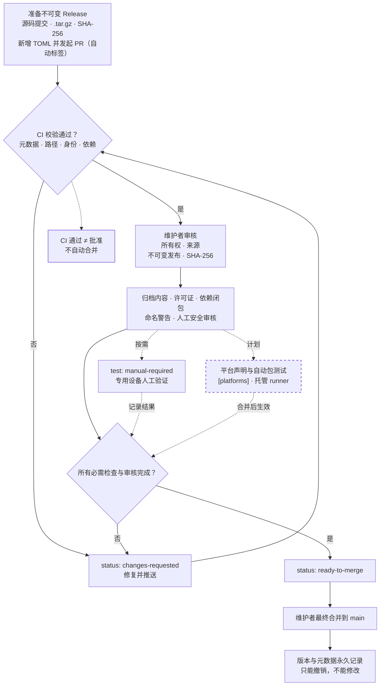

## 审核流程总览

[Bunko](https://github.com/mio-kobo/bunko-index) 是 Mio 的官方软件包索引。每个包版本都以一份 UTF-8 TOML 记录提交到 `packages/` 目录，并随 Pull Request 接受自动检查与维护者审核。索引本身不托管包源码；源码、发布归档和许可证仍属于发布者。

本页描述索引仓库的审核流程，不描述安装器的完整实现，也不把开放中的提案当作现行规则。

> **状态快照（2026-11-09）：** `main` 分支已实现 v1 元数据校验器、PR 自动标签和 `Validate packages` 工作流。`[platforms]` 平台声明、自动包测试和在线发布核验仍由开放的 [PR #2](https://github.com/mio-kobo/bunko-index/pull/2) 提议，合并前不会生效。按该 PR 的现状调查，Mio v2.1.0 也还没有 `mio bunko` 安装子命令。

### 完整审核流程图

图中的实线节点是当前 `main` 已实现或已由人工执行的步骤；虚线节点是 PR #2 提议、尚未合并的能力。虚线连线表示可选支路或尚未生效的路径。



### 两个不能混淆的结论

1. **自动检查通过不等于审核通过。** `Validate Bunko index` 只检查元数据与索引关系；它不自动下载包、不执行包代码，也不判断发布者是否真的拥有该账号。合并决定始终由维护者作出。
2. **标签不是权限。** `status: ready-to-merge` 表示维护者认为检查与审核已完成，不会触发自动合并；合并、关闭或撤销仍由维护者操作。

## 提交前准备

发布者在一个公开 GitHub 仓库中准备源码与发布归档，然后向索引仓库提交元数据记录。

1. **确定发布者身份。** 社区包的命名空间必须是拥有源码仓库的 GitHub 账号或组织的小写登录名。`kiso/*`、`mio/*` 与 `bunko/*` 是保留命名空间，需使用基础分支中的发布者与提交者白名单。
2. **固定源码提交。** 记录完整的 40 位小写提交 SHA，并确保发布标签指向该提交。
3. **创建不可变发布。** 在 GitHub 上发布一个非草稿 Release，启用不可变发布，上传 `.tar.gz` 源码归档。归档中不得包含子模块、原生二进制、符号链接、安装钩子或任意构建脚本；许可证与普通文档可以保留。
4. **记录发布证据。** 保存 `release_id`、归档资产 ID、`source_commit` 与下载字节的 SHA-256。
5. **添加元数据记录。** 按 [package format](https://github.com/mio-kobo/bunko-index/blob/main/docs/package-format.md) 写入 `packages/` 下对应的版本 TOML 记录，并为每个直接依赖指定精确版本。
6. **本地校验。** 在索引仓库中运行校验器，确认没有 `BUNKO_E_*` 错误。
7. **发起 PR。** 链接不可变 Release 与源码提交。如果 PR 提交账号与发布者账号不同，需提供维护者可以通过发布者控制渠道核实的授权证据。

```sh
python3 tools/validate.py
python3 tools/validate.py --base origin/main
python3 -m unittest discover -s tests -v
```

校验器只依赖 Python 3.11+ 标准库与 Git，不会下载或执行包。

## 元数据校验

### 记录格式

记录路径固定为：

```text
packages/<namespace>/<package>/<version>.toml
```

每条记录是一个不超过 64 KiB 的普通、不可执行 UTF-8 TOML 文件。当前 v1 记录包含以下字段：

| 字段 | 作用 |
| --- | --- |
| `name` | 精确的 `namespace/package`，两段均为小写 ASCII 字母、数字或单连字符 |
| `version` | 精确的 `MAJOR.MINOR.PATCH`，不允许前导零或版本范围 |
| `publisher` | `github:<lowercase-login>`，必须与命名空间一致，保留命名空间除外 |
| `description` | 非空单行描述，最多 240 字符 |
| `repository` | 发布者拥有的规范 GitHub 仓库 URL |
| `source_commit` | 与归档对应的完整 40 位提交 SHA |
| `release_id` | 正整数形式的 GitHub Release ID |
| `archive` | 同一仓库中上传归档资产的 GitHub API 资产 URL |
| `sha256` | 归档字节的 64 位小写十六进制摘要 |
| `license` | SPDX 许可证标识符；维护者仍需核对实际条款 |
| `mio` | 编译器兼容范围：`min` 包含下界，`before` 排除上界 |
| `dependencies` | 包名到精确版本的映射；空表表示零依赖 |

### 自动校验器实际检查什么

当前 `tools/validate.py` 会检查：

- 文件路径、文件名、文件模式和 UTF-8 TOML 大小；
- schema 允许的字段、类型、格式与长度；
- 路径中的包名和版本是否与记录内容一致；
- 发布者是否符合命名空间身份规则，保留命名空间是否获得基础分支授权；
- `repository`、`archive` 与 `publisher` 是否指向同一发布者；
- `mio.min` 是否严格早于 `mio.before`；
- 依赖是否使用精确版本、是否存在缺失包、缺失版本、环路、已撤销版本和单版本冲突；
- 已发布记录的字节与 Git 文件模式是否保持不变；
- 命名空间是否命中相似名称规则，命中时产生 `BUNKO_W_MANUAL_REVIEW` 警告。

错误使用 `BUNKO_E_*` 代码并以非零状态退出。`BUNKO_W_MANUAL_REVIEW` 只是警告，不会让校验器失败，但维护者必须记录命名警告的处置结果。当前校验器不会访问 GitHub API，也不会下载归档，因此“记录格式正确”不等于“发布内容已经核验”。

### GitHub Actions 中的两层校验

`Validate packages` 在 `pull_request` 上运行，并使用两层校验：

1. **基础分支校验器。** 工作流从 PR 的基础提交导出 `tools/`、`schemas/` 与 `policies/`，用旧的、可信的规则检查 PR。这样 PR 不能通过修改校验器来放宽自己的检查。
2. **提议规则校验器。** 随后用 PR 中的规则再检查一次，并运行校验器自身的单元测试。

类型、等待审核与命名标签由独立的 `Label Bunko pull requests` 工作流生成。它通过 `pull_request_target` 从可信基础分支运行，只读取 PR 的文件名和基础树，不检出、不下载、不执行 PR 代码，也不授予审核结论。

## 发布者所有权

发布者身份是审核的第一道边界，而自动校验只能验证字符串关系。

- **社区包：** 命名空间的发布者必须是 `github:<namespace>`，仓库也必须属于该账号或组织。
- **保留命名空间：** `kiso/*`、`mio/*`、`bunko/*` 使用 `policies/reserved-names.toml` 中的发布者列表和数字账号 ID 白名单。保留命名空间的提交者必须在基础分支白名单中；PR 不能通过修改自己的白名单来自我授权。授权变更需要先在独立策略 PR 中合并。
- **代提交：** 如果 PR 账号与发布者不同，提交者必须提供维护者可以通过发布者控制渠道验证的授权证据。
- **命名警告：** 与保留名称在视觉上相似或编辑距离过近的命名空间会被标记为 `review: naming`。警告本身不拒绝 PR，但维护者必须在审核记录中说明接受或拒绝的理由。

维护者审核时还会检查 `CODEOWNERS`、分支保护与发布者账号的实际控制关系。自动标签只提供线索，不代替这些判断。

## 来源、不可变发布与 SHA-256

来源证明把“索引中的一条记录”与“发布者实际发布的字节”连接起来。当前 `main` 的自动校验只验证以下字段之间的结构一致性：

- `source_commit` 是完整 40 位提交 SHA；
- `repository` 与 `archive` 指向同一发布者和仓库；
- `release_id` 是合法的 Release ID；
- `sha256` 是 64 位小写十六进制字符串；
- `mio` 范围格式与顺序正确。

真正的来源核验由维护者人工完成：

1. 确认 Release 已发布、不是草稿，并报告 `immutable: true`。
2. 确认归档资产 ID 属于该 Release，且资产未被替换。
3. 确认 Release 标签解析到记录中的 `source_commit`。
4. 下载归档，核对字节的 SHA-256 与 `sha256` 完全一致。GitHub 可能重定向到下载主机，摘要必须针对最终下载到的字节计算。
5. 检查归档内容与源码提交一致，没有安装钩子、脚本、原生二进制、符号链接或其他禁止内容。
6. 确认许可证允许再分发，并核对 SPDX 标识与实际条款。

不可变发布是永久记录的前提。发布后不能修改记录内容来“修复”摘要或源码提交；应发布新版本并新增记录。PR #2 计划把这些在线检查（Release 不可变性、标签到提交、资产 ID、下载摘要）纳入 CI，但在合并前它们仍是人工步骤。

## 依赖兼容性

Bunko v1 只接受精确的直接依赖，不接受 `latest`、`^1.0.0` 或 `~1.0.0` 这类浮动值。

- 每个依赖都必须在索引中已有对应版本；
- 校验器独立检查每个可用 release 的依赖闭包；
- 闭包中不能出现环路、缺失包、无效记录、已撤销版本或同一包的多版本冲突；
- 一个项目最终只能为每个包选择一个版本，索引不会自动选择“更新”的版本；
- 使用 `--roots` 可以把项目的一组直接依赖放在一起检查。

```sh
python3 tools/validate.py --roots alice/web@1.0.0 carol/api@2.0.0
```

撤销通过 `policies/revoked-versions.toml` 记录。撤销不会删除历史记录；任何依赖闭包触达被撤销版本的 release 都会被拒绝。当前依赖检查不包含平台闭包，平台声明与平台依赖检查属于 PR #2 的计划。

## 平台声明与平台测试

> **当前不要求 `[platforms]`。** `main` 分支的 v1 schema 没有平台字段；在 PR #2 合并前，给记录添加 `[platforms]` 不是现行审核要求，也不会被当前 schema 接受。

PR #2 提议将 `[platforms]` 设为必填，并把“声明的目标”与“CI 能测试的目标”绑定：

| 目标 | GitHub 托管 runner | Mio v2.1.0 编译器资产 |
| --- | --- | --- |
| `linux/x86_64` | `ubuntu-24.04` | `mio-2.1.0-linux-amd64-full.tar.gz` |
| `macos/arm64` | `macos-15` | `mio-2.1.0-darwin-arm64-full.tar.gz` |
| `windows/x86_64` | `windows-2025` | `mio-2.1.0-windows-amd64-full.zip` |

计划规则包括：

- 只接受 `linux`、`macos`、`windows`，架构只接受 `x86_64` 与 `arm64`；
- 没有默认平台，空数组、重复值、通配符和别名都是错误；
- 未声明的系统或架构视为不支持，即使源码理论上可以编译；
- 依赖闭包中的每个 release 都必须声明根包所需的全部目标，否则报告 `BUNKO_E_PLATFORM_DEPENDENCY`；
- 只允许 Mio 官方编译器与可信 GitHub 托管 runner 能够覆盖的目标；当前为 Mio v2.1.0 的上述三项。

这套规则尚未生效。当前记录没有平台字段，维护者只能人工评估测试结果；不能把计划中的自动矩阵描述为已经运行。

## GitHub Actions 测试的现状与计划

### 当前已运行的检查

| 工作流 | 触发 | 实际作用 |
| --- | --- | --- |
| `Validate packages` | `pull_request` | 用基础分支校验器、PR 校验器和校验器单元测试检查索引 |
| `Label Bunko pull requests` | `pull_request_target` | 只添加类型、等待审核与命名警告标签 |

当前 CI **不执行包代码**。归档内容、发布不可变性、SHA-256 和许可证仍由维护者在本地或 GitHub 页面人工核验。因此，看到绿色检查时不能推断包已经通过安全审核。

### PR #2 提议的包测试

PR #2 计划增加 `test-packages.yml`，对每个新增包版本执行：

1. **Plan：** 从基础分支工具读取记录与 `[platforms]`，为每个声明目标生成矩阵任务。
2. **Verify：** 下载固定 Mio v2.1.0 资产，核对 SHA-256；检查 Release 已发布且不可变、资产属于该 Release、标签解析到 `source_commit`、包归档摘要一致。
3. **Extract：** 在运行包代码前按归档策略解压，拒绝路径穿越、符号链接、可执行文件等违规内容。
4. **Test：** 把依赖放到标准库旁，设置 `MIO_BUNKO`，运行 `mio test <namespace>/<package>/... --format=json`。至少一个测试通过、零失败、所有含测试的目录都实际运行，才算通过。

计划中的任务只使用 GitHub 托管 runner，不使用 self-hosted runner、仓库密钥或私有硬件；测试步骤不携带凭据，矩阵任务 `fail-fast: false`，单个目标失败不会隐藏其他目标。该工作流在 PR #2 合并前不存在。

## 人工安全审核

包归档、测试源码、文件名与元数据都属于不可信输入。当前 CI 不执行包代码，所以维护者的人工审核是唯一的安全审查环节。

维护者应至少确认：

- 归档中没有安装脚本、构建脚本、原生二进制、符号链接、设备文件或其他可执行内容；
- 源码没有未声明的网络、文件系统、进程或环境访问，或这些访问已在包文档中说明；
- 依赖闭包没有已撤销、来源不明或与声明不符的版本；
- 许可证允许索引与用户再分发，且与记录中的 SPDX 标识一致；
- 命名与描述不会误导用户以为这是官方或保留命名空间的包；
- 发布者确实控制源码仓库与发布账号，代提交授权可验证。

发现安全问题时应使用仓库的[私密漏洞报告](https://github.com/mio-kobo/bunko-index/security/advisories/new)（如可用）或既有私下渠道，不要公开利用细节。已经发布的版本通过撤销流程处理：保留历史记录，在 `policies/revoked-versions.toml` 中登记精确的 `name@version` 和公开公告链接，并在同一个 PR 中撤销依赖闭包含该版本的已发布 release。

## 专用硬件测试

某些目标架构、旧机器或硬件相关行为无法由 GitHub 托管 runner 覆盖。此时维护者可以在专用设备上进行人工测试：

- 使用与记录完全一致的发布归档，先核对 SHA-256；
- 使用固定版本的 Mio 编译器构建并运行包测试；
- 记录设备、操作系统、架构、编译器版本、源码提交与测试结果；
- 通过 `test: manual-required` 标记需要人工测试，完成后由维护者添加 `test: manually-verified`；
- 把结果写进 PR 审核记录，而不是只留在聊天或本地日志中。

专用硬件结果不会自动改变元数据或声明支持范围。计划中的 `[platforms]` 规则仍只承认索引能够用官方编译器和托管 runner 测试的目标；人工结果不会把一个不可测试的目标变成“支持”。计划中的 CI 也不会向 self-hosted runner 或私有硬件派发任务。

## 最终批准与合并

自动检查、标签机器人和计划中的包测试都不能批准 PR。最终批准与合并由拥有写权限的维护者完成，并应满足：

- 基础分支的必需检查（至少 `Validate Bunko index`）通过；
- `CODEOWNERS` 或分支保护要求的审核已完成；
- 所有权、来源、不可变发布、SHA-256、归档、许可证、依赖、命名和人工安全审核都有明确结论；
- 需要专用硬件测试时，结果已记录并得到维护者确认；
- 没有未解决的阻塞讨论或 `status: blocked`。

维护者确认后设置 `status: ready-to-merge`，再由维护者执行合并。标签本身不授予权限，CI 和机器人也不会自动合并。合并后，版本记录成为永久历史：不能编辑已发布记录；修复需要发布新版本，安全问题通过撤销流程处理。

如果仓库尚未启用分支保护或必需检查，维护者仍应按上述边界人工把关；贡献指南要求在引导完成后配置这些保护。

## PR 标签

标签分为类型、状态、审核、测试与优先级几组。只有 `type:*`、初始的 `status: awaiting-review` 和启发式的 `review: naming` 会自动添加；其余标签由维护者设置。自动标签器只协调 `type:*` 标签，不会删除状态、审核、测试或优先级标签。

### 类型标签

| 标签 | 含义 | 分配 |
| --- | --- | --- |
| `type: new-package 🍓` | 提交新的 Mio 软件包 | 自动：新增记录且基础树中无同包记录 |
| `type: new-version 🆙` | 提交已有软件包的新版本 | 自动：新增记录且基础树中已有同包记录 |
| `type: revocation 🚫` | 撤销不安全或无效的已发布版本 | 自动：修改 `policies/revoked-versions.toml` |
| `type: documentation 📚` | 文档与指南变更 | 自动：仅修改 `docs/`、`README.md`、`CONTRIBUTING.md` 或 `SECURITY.md` |
| `type: infrastructure ⚙️` | CI、工具、schema 或测试基础设施变更 | 自动：修改 `.github/`、`tools/`、`schemas/` 或 `tests/` |
| `type: policy 📜` | 包策略或审核要求变更 | 自动：修改 `policies/` |

当一次 PR 同时触及多个类别时，标签器按基础设施、撤销、策略、包提交、文档的顺序选择，可能同时添加多个包类型标签。

### 状态标签

| 标签 | 含义 | 分配 |
| --- | --- | --- |
| `status: awaiting-review 👀` | 等待维护者审核 | 自动：非草稿 PR 且尚无任何状态标签 |
| `status: reviewing 🔍` | 维护者正在审核 | 维护者 |
| `status: changes-requested 📝` | 维护者要求修改 | 维护者 |
| `status: ready-to-merge ✅` | 必需检查与审核已完成，等待合并 | 维护者；不触发自动合并 |
| `status: blocked ⛔` | 被未解决的问题阻塞 | 维护者 |

### 审核关注标签

| 标签 | 含义 | 分配 |
| --- | --- | --- |
| `review: ownership 🪪` | 发布者所有权或授权需要核验 | 维护者 |
| `review: provenance 🔗` | 源码提交、不可变发布或归档需要核验 | 维护者 |
| `review: license ⚖️` | 许可证需要额外审核 | 维护者 |
| `review: security 🛡️` | 需要额外安全审核 | 维护者 |
| `review: naming 🧐` | 包命名需要人工判断 | 自动：命名空间命中相似规则；维护者负责处置并移除 |

### 测试与优先级标签

| 标签 | 含义 | 分配 |
| --- | --- | --- |
| `test: missing 🧩` | 缺少必需的包测试 | 维护者 |
| `test: cross-platform 🌐` | 包测试在多个平台通过 | 维护者 |
| `test: manual-required 🖥️` | 需要在专用硬件上人工测试 | 维护者 |
| `test: manually-verified 🧪` | 维护者已完成人工验证 | 维护者 |
| `priority: critical 🚨` | 需要立即处理的严重问题 | 维护者 |
| `priority: high 🔥` | 高优先级 | 维护者 |
| `priority: normal 🍵` | 普通优先级 | 维护者 |
| `wontfix` | 不会处理或不会合并 | 维护者 |

## 已实现与计划中

| 能力 | 当前 `main` | PR #2（未合并） |
| --- | --- | --- |
| v1 元数据 schema 与校验器 | 已实现 | 扩展 `[platforms]` 与平台闭包 |
| 类型、等待审核、命名警告标签 | 已实现 | 可能增加平台提示 |
| 在线核验 Release 不可变性、标签到提交、资产与 SHA-256 | 维护者人工 | 计划自动化 |
| 归档内容策略检查 | 维护者人工 | 计划自动化 |
| `[platforms]` 声明 | 尚无此字段 | 计划设为必填 |
| 包测试 | 无；CI 不执行包代码 | 计划在 GitHub 托管 runner 上按平台矩阵运行 |
| 平台依赖闭包 | 无 | 计划检查 |
| 专用硬件测试 | 维护者按需人工执行 | 仍为人工；不派发到私有硬件 |
| 撤销流程 | 已实现策略文件与校验器 | 保持不变 |
| 分支保护与必需检查 | 贡献指南要求配置，仓库实际设置需单独确认 | 计划把 `Package tests` 纳入必需检查 |

## 维护者合并前检查清单

- 确认 PR 的每个记录路径、包名和版本一致，且没有修改已发布记录。
- 确认发布者身份、保留命名空间授权或代提交证据。
- 确认 Release 已发布且不可变，标签解析到 `source_commit`。
- 下载归档并核对 SHA-256，检查归档内容和许可证。
- 检查依赖闭包、撤销状态与单版本约束。
- 处置命名警告并记录理由。
- 完成人工安全审核；需要时安排专用硬件测试。
- 确认状态标签反映实际审核状态，而不是只依赖 CI 绿色。
- 由维护者执行最终合并；CI、标签机器人和 PR 作者都不能代替这一步。

## 延伸阅读

- [Bunko Package Index](https://github.com/mio-kobo/bunko-index)
- [贡献指南](https://github.com/mio-kobo/bunko-index/blob/main/CONTRIBUTING.md)
- [包元数据格式](https://github.com/mio-kobo/bunko-index/blob/main/docs/package-format.md)
- [包测试提案 PR #2](https://github.com/mio-kobo/bunko-index/pull/2)（尚未合并）
- [安全与撤销说明](https://github.com/mio-kobo/bunko-index/blob/main/SECURITY.md)
- [Core、Full 与发行包](/docs/v2.1/tooling/distribution)
- [验证与来源](/docs/v2.1/tooling/verification)
- [Native CLI](/docs/v2.1/tooling/native-cli)
- [SHA-256 标准库](/docs/v2.1/kiso/crypto-sha256)
